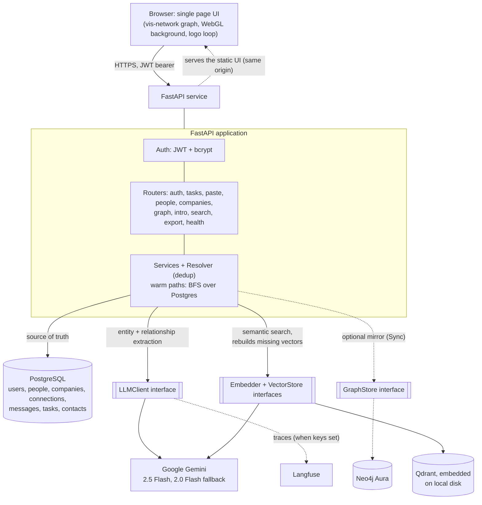

# Kith

Kith is a relationship intelligence platform. It reads the messages you get, extracts the
people and the companies behind them, maps how everyone is connected, and answers the
question that actually matters when you are job hunting or networking: who can get me into
a given company. It also runs a daily task list and a searchable, visual map of your
network.

Live: https://kith-1a3z.onrender.com

This is a personal product and a portfolio project. The goal was to build something real
end to end: ingestion, an AI extraction step, a relational source of truth, multi-hop
warm-path search, a vector index for semantic search, an optional graph-database mirror,
an evaluation harness, a single-page UI, and a public deployment.

## What it does

- Capture contacts three ways: paste an email or message and let AI extract the entities,
  add a person by hand, or click a person in the graph to add someone they know.
- Build a relationship graph of people, companies, and the links between them
  (works at, knows, referred, can introduce).
- Answer warm-path questions: "who can get me into Qualcomm" returns a path such as
  You, Dipunj, Rahul, Qualcomm (up to four hops).
- Search the network by meaning, not keywords ("talent acquisition" finds the recruiters).
- Keep a task list with optional deadlines, priorities, and drag-to-reorder.
- Browse every contact in a People list with a hot, warm, or cold status and private notes.
- Store contact details (role, email, phone, LinkedIn) and open Gmail compose or a
  LinkedIn profile in one click.
- Export all of your data as a JSON backup.

## Architecture



### How the pieces fit

- **Single source of truth is PostgreSQL.** Neo4j and Qdrant are derived stores that are
  rebuilt from Postgres. This keeps writes simple and means an outage in a derived store
  never blocks the core app.
- **The AI layer sits behind an `LLMClient` interface.** Extraction is a single
  structured-output Gemini call (Gemini 2.5 Flash, falling back to 2.0 Flash when the
  primary is overloaded) that returns people, companies, titles, notes, and relationships
  as typed JSON. On failure it raises a typed error so the API returns a clean 503 instead
  of a crash. Swapping providers is a new class, nothing else changes.
- **Warm paths are a breadth-first search over the Postgres graph** (up to four hops) in
  `services/intro_paths.py`. The first version ran this as a Cypher query on Neo4j Aura.
  When the free Aura instance was paused and later deleted for inactivity, the feature
  failed with it, so path finding moved to Postgres, which is always available. Neo4j
  stays as an optional mirror behind a `GraphStore` interface (Tools, "Sync graph to
  Neo4j"); the sync reports failure instead of erroring if Neo4j is unreachable.
- **Semantic search uses Gemini embeddings indexed in Qdrant**, behind `Embedder` and
  `VectorStore` interfaces with fakes for testing. Qdrant runs embedded on the server's
  disk, which the free host wipes on every deploy, so before each search any people
  missing from the index are embedded in one batched call and added. The index heals
  itself from Postgres instead of needing a manual reindex.
- **Observability is optional and non-blocking.** A tracer records each extraction
  (input, output, model, latency, error) to Langfuse when keys are set and is a no-op
  otherwise. It is not switched on in the live deployment.
- **Deduplication** of people is centralized in a Resolver: a name that matches an
  existing contact after trimming and lowercasing resolves to the same person, for both
  paste ingestion and manual entry. Companies are deduplicated the same way.

## Tech stack

| Area | Choice |
|------|--------|
| API | FastAPI (Python) |
| Auth | JWT (PyJWT) with bcrypt password hashing |
| Relational store | PostgreSQL via SQLAlchemy 2.0 (SQLite for local and tests) |
| Warm paths | Breadth-first search over PostgreSQL |
| Graph mirror | Neo4j (Aura free tier), optional |
| Vector store | Qdrant (embedded mode) with Gemini embeddings (`gemini-embedding-001`) |
| AI | Google Gemini 2.5 Flash with 2.0 Flash fallback, structured output, provider-agnostic interface |
| Observability | Langfuse (optional, off unless keys are set) |
| Frontend | Single static HTML page, vanilla JS, vis-network, WebGL gradient |
| Tests | pytest, hermetic (fakes for AI, graph, and vector layers; no network calls) |
| Deployment | Render web service, Neon PostgreSQL |

## Data model (PostgreSQL, source of truth)

- `users`: account with bcrypt-hashed password.
- `people`: a contact (name, title, current company link, source message).
- `companies`: a company, deduplicated per user by normalized name.
- `connections`: directed person-to-person edges with a relation type
  (knows, referred, can_intro).
- `messages`: raw captured text plus a processed flag.
- `contacts`: one-to-one with a person, holding email, phone, and LinkedIn.
- `tasks`: a to-do with optional deadline and priority.

Neo4j, when synced, mirrors people, companies, and connections as a queryable graph.
Qdrant holds one embedding per person for semantic search. Both are derived from Postgres
and can be rebuilt from it at any time.

## API overview

All data endpoints require a JWT bearer token.

- `POST /auth/register`, `POST /auth/login`, `GET /auth/me`
- `POST /paste`: extract people, companies, and relationships from a message
- `GET /people`, `POST /people`, `GET /people/{id}`, `PATCH /people/{id}`,
  `DELETE /people/{id}`, `POST /people/reorder`
- `PATCH /companies/{id}`, `DELETE /companies/{id}`
- `GET /graph`: the network as nodes and edges
- `GET /intro-paths?company=...`: warm paths to a company (computed from Postgres)
- `POST /graph/sync`: mirror the user subgraph into Neo4j (best effort)
- `GET /search?q=...`: semantic search (indexes any missing people first);
  `POST /search/reindex`: re-embed everyone, for example after editing profiles
- `GET /tasks`, `POST /tasks`, `PATCH /tasks/{id}`, `DELETE /tasks/{id}`,
  `POST /tasks/reorder`
- `GET /export`: all of the signed-in user's data as JSON
- `GET /health`

## Run it locally (no Docker)

The whole app runs against a local SQLite file, so nothing external is required to start.

```bash
cd backend
python -m venv .venv
.venv\Scripts\activate            # Windows. macOS or Linux: source .venv/bin/activate
pip install -r requirements-dev.txt

set DATABASE_URL=sqlite:///./kith_local.db   # PowerShell: $env:DATABASE_URL="sqlite:///./kith_local.db"
python -m uvicorn app.main:app --reload
```

Open http://localhost:8000, register an account, and start adding contacts. Pasting a
message and semantic search need a Google Gemini API key in `backend/.env`
(`GEMINI_API_KEY=...`). Warm paths need nothing extra. Neo4j credentials are only needed
for the optional graph mirror.

To fill a separate, fictional demo account (12 people, tasks, a two-hop warm path):

```bash
cd backend
python scripts/seed_demo.py                       # local server
python scripts/seed_demo.py --base https://...    # any deployment
```

It never deletes anything, saves the generated password to the gitignored
`backend/.demo_credentials`, and checks paths and search before printing DEMO READY.

### Tests

```bash
cd backend
python -m pytest -q
```

The suite (over 100 tests) is hermetic: the AI, graph, and vector layers use in-memory
fakes, and a run with every non-local network lookup blocked passes, so no API keys or
external services are needed.

### Evaluations

Extraction quality is measured against 12 hand-labeled messages (`evals/cases.py`) with a
per-category precision, recall, and F1 scorer (`evals/scorer.py`). The runner makes real
Gemini calls and is run on demand, not on every extraction:

```bash
cd backend
python -m evals.run_evals     # uses a real Gemini key, about 3 minutes
```

Latest run (`evals/results/2026-10-27-gemini-2.5-flash.txt`):

| Category | Precision | Recall | F1 |
|----------|-----------|--------|----|
| People | 1.00 | 1.00 | 1.00 |
| Companies | 1.00 | 1.00 | 1.00 |
| Relationships | 0.92 | 1.00 | 0.92 |

The one miss is a relationship the model inferred that the message does not state.

## Deployment

- Single Render web service runs the FastAPI app and serves the UI from the same origin.
- PostgreSQL is hosted on Neon (persistent). Qdrant runs embedded on the service's disk,
  which is reset on each deploy and rebuilt from Postgres on the next search. Neo4j Aura
  is optional.
- A lifespan task pings the service every ten minutes (and an external HTTP monitor backs
  it up) so the free host does not cold start between visits.
- Configuration is environment driven: `DATABASE_URL`, `JWT_SECRET`, `GEMINI_API_KEY`,
  and optional `NEO4J_*` and `LANGFUSE_*`.

## Designed but deferred

The original design (written before any code) planned two more pieces that are
deliberately not built yet:

- **Gmail auto-sync** over OAuth, so new emails are captured without pasting. Deferred to
  keep the app free to run, avoid ingesting noisy mail, and avoid storing mailbox tokens.
- **A LangGraph agent pipeline** (extractor, resolver, graph writer, follow-up drafter).
  Today these are plain functions: one extraction call followed by deterministic
  resolution and storage, which has been enough at this scale.

## Project structure

```
backend/
  app/
    main.py            app wiring, static mount, keep-alive
    config.py          settings
    database.py        SQLAlchemy engine and session
    security.py        bcrypt and JWT
    deps.py            auth and dependency injection
    models/            User, Company, Message, Person, Connection, Task, Contact
    schemas/           request and response models
    routers/           auth, paste, people, companies, graph, intro, search, tasks,
                       export, health
    services/          ingest, resolver, intro_paths, graph_sync, graph_view, people,
                       companies, connections, contacts, tasks
    llm/               LLMClient interface, Gemini implementation, errors
    graph/             GraphStore interface, Neo4j and fake implementations
    search/            Embedder and VectorStore interfaces and implementations
    observability/     tracer (Langfuse or no-op)
  evals/               dataset, scorer, runner, recorded results
  scripts/             demo seeder and smoke checks
  tests/               20 hermetic test modules
frontend/
  index.html           single-page UI
  privacy.html         privacy policy and terms
```

## Disclaimer

Built by Archit Shukla and Saumya Singh. We designed the system, made the architecture
and product decisions, chose the data stores and the boundaries between them, and
integrated and deployed it. Claude Code (Anthropic) was used as a pair-programming
assistant to help implement and review code under our direction. The design, the
decisions, and the ownership of this project are ours.
